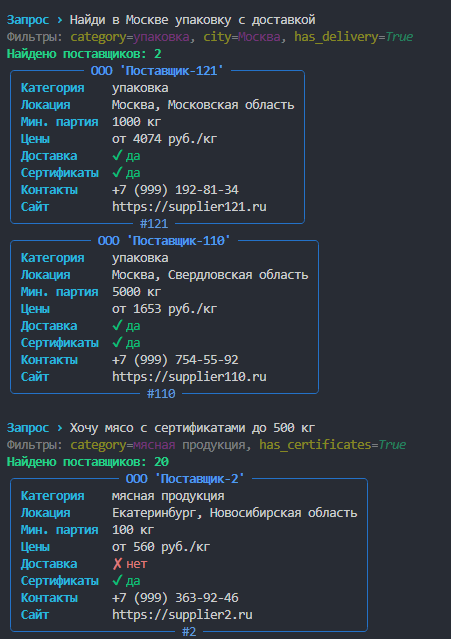

# CLI-сервис поиска поставщиков продуктов питания

Прототип интеллектуального поиска по базе поставщиков на естественном языке.

## Архитектура

1. **Query Understanding (LLM):** Пользователь вводит запрос на естественном языке.
2. **Structured Output (Pydantic + Instructor):** LLM извлекает параметры поиска в строго типизированную модель `SearchFilters`. 
3. **Safety & Security:** LLM **не пишет SQL**. Она только заполняет фильтры. SQL-запрос формируется на стороне Python с использованием параметризованных запросов (защита от SQL-инъекций).
4. **Search:** SQLite + динамический WHERE.
5. **Presentation:** Вывод карточек через `rich`.

## Ключевые инженерные решения (Trade-offs)

- **Почему не RAG / Vector Search?** Данные структурированы (SQLite), а категории фиксированы. Векторный поиск здесь — оверкилл. Я использую LLM для маппинга естественного языка в строгие SQL-фильтры, что быстрее и дешевле.
- **Controlled Vocabulary:** Поле `category` в Pydantic — это `Literal`. LLM физически не может выдумать категорию, которой нет в базе. Это решает проблему галлюцинаций на уровне схемы.
- **Почему `instructor`?** Обеспечивает надежный Structured Output (автоматические ретраи при невалидном JSON) поверх OpenAI API.
- **Cyrillic Case Sensitivity:** SQLite не умеет в `LIKE` для кириллицы без расширений. Я зарегистрировал кастомную функцию `casefold` прямо в соединении, чтобы поиск по городу/региону был регистронезависимым.

## Как запустить

1. Установите зависимости: `pip install pydantic instructor openai rich python-dotenv`
2. Создайте `.env` на основе `.env.example`.
3. Сгенерируйте данные: `python generate_data.py`
4. Запустите: `python main.py`

## Что бы я добавил в проде (Next Steps)

- Переход на PostgreSQL + `pgvector`, если появятся неструктурированные описания поставщиков.
- Semantic matching для категорий (через `bge-m3`), чтобы ловить синонимы ("помидоры" -> "бакалея").
- Покрытие тестами (`pytest`) для слоя `extract_filters` с моками LLM.
- Контейнеризация (Docker) и вынос в FastAPI, если понадобится веб-интерфейс.